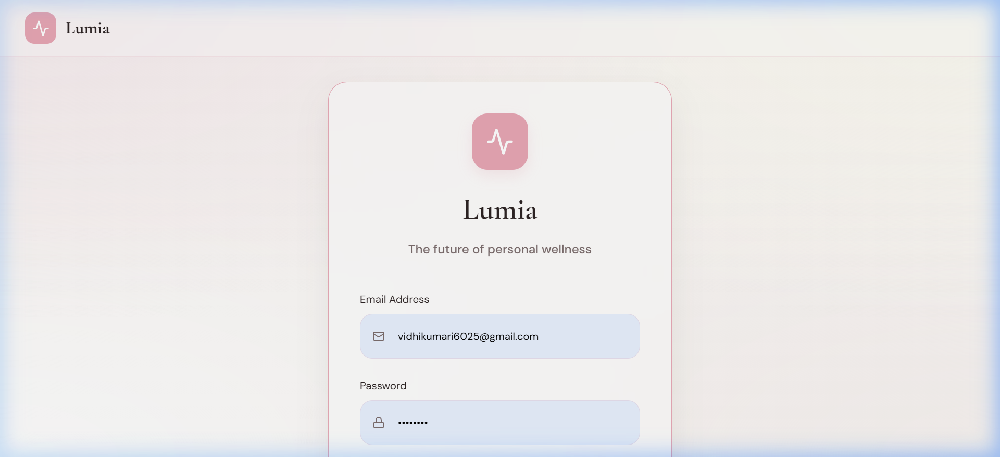
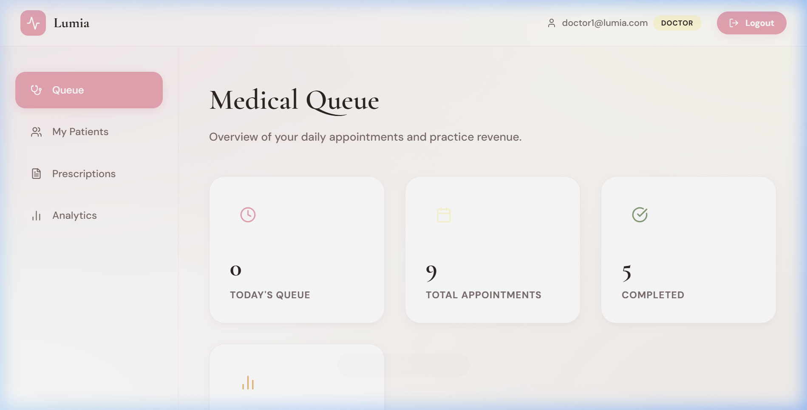
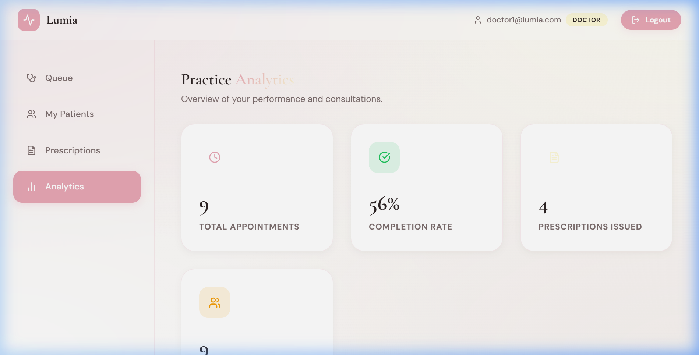

# Lumia Wellness Healthcare Platform

A modern, full-stack healthcare platform designed to streamline the consultation workflow between doctors and patients. It offers distinct portals for patients (to book appointments), doctors (to manage appointments, issue prescriptions, and track revenue), and administrators (to verify doctors and oversee the platform).

## 🚀 Live Deployment

- **Frontend App**: [https://meditrack-rouge.vercel.app](https://meditrack-rouge.vercel.app)
- **Backend API**: [https://meditrack-zetl.onrender.com](https://meditrack-zetl.onrender.com)

### Demo Credentials
| Role | Email | Password |
| :--- | :--- | :--- |
| **Doctor** | `doctor1@lumia.com` | `doc123` |
| **Patient** | `patient1@lumia.com` | `pat123` |
| **Admin** | `admin@lumia.com` | `admin123` |

---

## ✨ Features

### 👨‍⚕️ Doctor Portal
- **Dashboard**: View upcoming appointments and securely mark them as completed with custom fee collection.
- **My Patients CRM**: An organized view of all patients, tracking comprehensive details including the 'Total Fees Paid' by each patient.
- **Analytics**: Track total revenue, patient count, and consultation trends with visual data representation.

### 🧑 Patient Portal
- **Appointments**: Effortlessly book, reschedule, or cancel consultations with verified doctors.
- **Health Records**: View digital prescriptions and post-visit notes.

---

## 📸 Platform Screenshots

### Secure Login

*Role-based secure authentication system for Doctors, Patients, and Admins.*

### Doctor Dashboard

*A premium, organized view of the day's appointments and vital statistics.*

### Interactive Fee Collection (Consultation Completion)

*A custom modal for doctors to quickly record consultation fees upon completing an appointment, automatically updating analytics.*

### Revenue Analytics

*Real-time tracking of patient flow and revenue generation.*

---

## 🛠️ Tech Stack

- **Frontend**: React, Vite, Lucide React icons, and a custom CSS design system optimized for a premium wellness aesthetic.
- **Backend**: Node.js, Express.js.
- **Database**: PostgreSQL (hosted on Neon.tech).
- **Deployment & Cloud**:
  - **Vercel** (Frontend SPA with custom routing).
  - **Render** (Node.js backend with automated migrations on boot).

---

## 💻 Local Development Setup

### Project Structure
The project is organized into a monorepo setup containing the frontend and backend architectures:
- `/lumia-frontend` - React Vite application.
- `/lumia-backend` - Node.js Express server.

### Prerequisites
- Node.js (v18+)
- PostgreSQL Database

### 1. Backend Setup
\`\`\`bash
cd lumia-backend
npm install
\`\`\`
Create a `.env` file based on the provided `.env.example` and add your local PostgreSQL `DATABASE_URL`.
\`\`\`bash
# Start the server (runs on port 3000 by default)
# Note: Migrations will run automatically on boot if DB is empty
npm run dev
\`\`\`

### 2. Frontend Setup
\`\`\`bash
cd lumia-frontend
npm install
\`\`\`
Ensure your local `VITE_API_BASE` points to `http://localhost:3000/api`.
\`\`\`bash
npm run dev
\`\`\`
